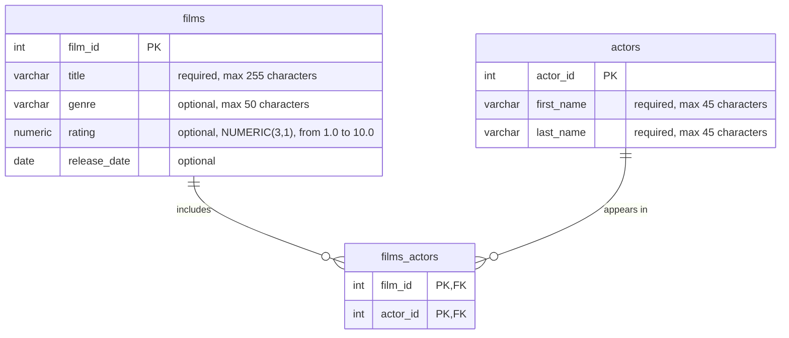

# Faker usage example

Fill a PostgreSQL database with fake movie data using Faker, pandas and SQLAlchemy.

What you can see in this project:

- a custom Faker provider (`fake.film_genre()`)
- reproducible data: the same seed always gives the same rows
- generation code as plain functions with type hints, separate from the database code
- PostgreSQL in Docker Compose
- pytest tests, including tests against a real database

## Data schema



`films_actors` is a link table: one film has many actors, and one actor plays in many films.

The schema is inspired by [this Codewars task](https://www.codewars.com/kata/5818bde9559ff58bd90004a2/sql) (table names and some column types are adapted). This project does not solve the task.

## Quick start

You need Python 3.11 or newer and Docker.

1. Install the dependencies in a virtual environment:

   ```bash
   pip install -r requirements.txt
   ```

2. Create the settings file and set your own password in it (the database takes the password on its first start; to change it later, delete the data with `docker compose down -v` first):

   ```bash
   cp .env.example .env
   ```

3. Start PostgreSQL:

   ```bash
   docker compose up -d
   ```

4. Create the tables and fill them with data:

   ```bash
   python main.py
   ```

You should see `Loaded 300 actors, 100 films, 990 film-actor links`. The sizes are set in `main.py`.

`main.py` empties the three tables before loading, so you can run it again and again. Do not run it on a database with data you want to keep.

To look at the data (use the user and database name from your `.env`):

```bash
docker compose exec db psql -U movies -d movies -c "SELECT * FROM films LIMIT 5;"
```

After that, open `demo.ipynb`: it shows how the data is generated and runs example queries (it needs `requirements-dev.txt`).

To stop the database, run `docker compose down`. The data stays in a Docker volume; add `-v` to delete it too.

## Project structure

```text
sql/schema.sql    table definitions
src/db.py         connection, schema, loading
src/generate.py   fake data: actors, films, film-actor links (no database code)
tests/            pytest tests
compose.yml       PostgreSQL in Docker
demo.ipynb        data generation demo and example queries
main.py           runs everything
```

## Tests

```bash
pip install -r requirements-dev.txt
pytest
```

Tests without a database always run. The database tests use a separate database `movies_test` and are skipped if PostgreSQL is not available. Create it once:

```bash
docker compose exec db psql -U movies -d movies -c "CREATE DATABASE movies_test;"
```

To run only one group: `pytest -m "not integration"` (no database) or `pytest -m integration` (database only).

## Design decisions

- **One seed, one Faker object.** `make_faker(seed)` seeds only its own object (`seed_instance`), not all Faker objects like `Faker.seed()`. The functions take random values only from this object, never from `random` or `DataFrame.sample`, so the same seed gives the same data.
- **About 10 actors per film.** Film-actor pairs are drawn at random with repeats and duplicates are dropped, so there are a bit fewer pairs than draws (990 of 1000).
- **Ratings** are from 1.0 to 10.0 with one decimal, as in the `NUMERIC(3,1)` column.
- **Release dates** are in a fixed range (1990-01-01 to 2026-10-31), not "until today", so the result does not depend on the day you run the code.
- **One transaction for loading.** If one table fails to load, nothing is saved.
- **Port 5433** on your computer, so it does not clash with another PostgreSQL on the default port 5432. Change `POSTGRES_PORT` in `.env` if you need another port.

## Useful links

- [Faker documentation](https://faker.readthedocs.io/en/latest/)
- [Generate fake data for Spring PetClinic with Pandas and Faker](https://www.feststelltaste.de/generate-fake-data-for-spring-petclinic-with-pandas-and-faker/)
- [Generating Fake CSV Data With Python](https://blog.dennisokeeffe.com/blog/2021-08-11-generating-fake-csv-data-with-python)
- [Generate (fake) data: Populating databases and DataFrames using simple Python packages](https://medium.com/@gilbertbarrios89/generate-fake-data-populating-databases-and-dataframes-using-simple-python-packages-that-can-1b17bc6c0144)
